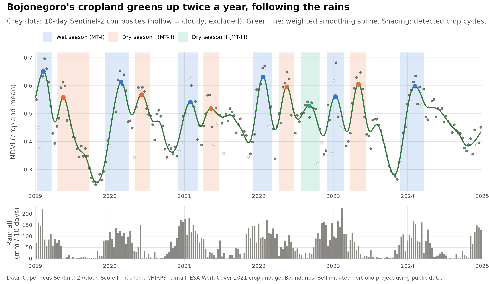
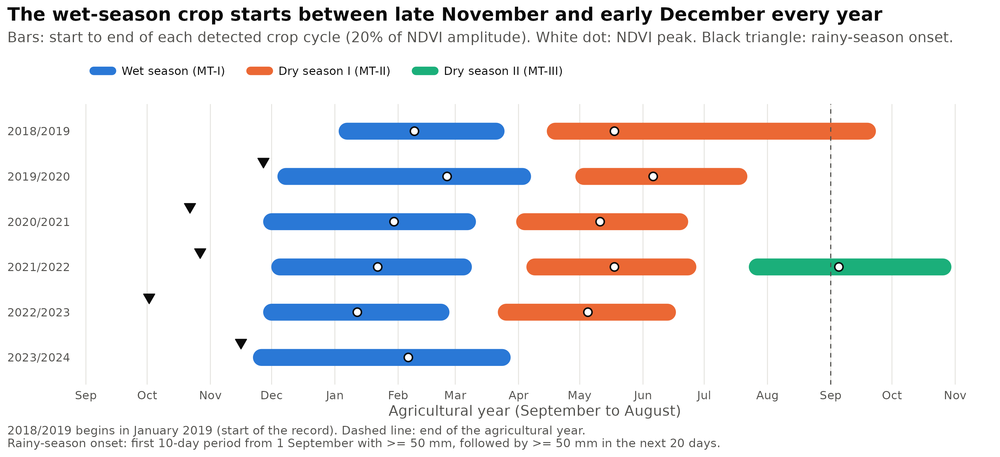
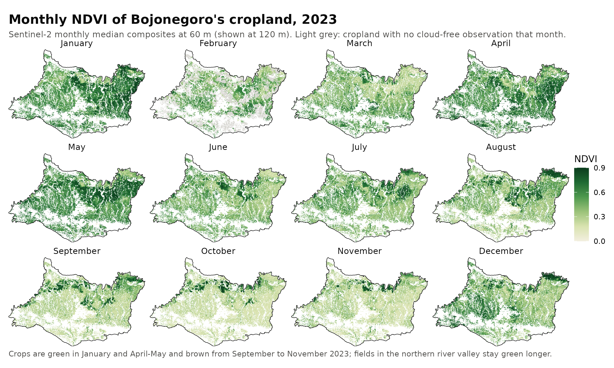

# Cropping Cycles from Space: Sentinel-2 NDVI and Rainfall

*Self-initiated portfolio project using public data.*
Author: Utik Tri Wulan Cahya, PhD

How many crops per year are grown on the cropland of Bojonegoro Regency (East Java, Indonesia), and how does the cropping calendar follow the rains? This project answers that from six years of Sentinel-2 imagery processed in **Google Earth Engine**, with the time series analysed in **R**.



## Data

| Dataset | Use | Licence / credit |
|---|---|---|
| Copernicus Sentinel-2 Surface Reflectance (harmonized), 2019–2024 | NDVI and NDWI | Contains modified Copernicus Sentinel data |
| Cloud Score+ (Google) | Cloud and shadow masking | Pasquarella et al. (2023) |
| CHIRPS daily rainfall | Rainfall per 10-day period | Funk et al. (2015), Climate Hazards Center, UCSB |
| ESA WorldCover 2021 (10 m) | Cropland mask (class 40) | CC BY 4.0 |
| geoBoundaries v6 | Regency boundary | CC BY 4.0 |

Study area: Bojonegoro Regency, 2,313 km², of which 949 km² (41%) is cropland with usable NDVI data.

## Methods

**In Google Earth Engine** (`P3_cropping_cycles_GEE.js`)
1. Masked clouds in every Sentinel-2 image with Cloud Score+ (clear-sky threshold 0.60).
2. Calculated **NDVI** (greenness) and **NDWI** (NIR–SWIR; canopy and surface wetness).
3. Built 10-day median composites from 2019 to 2024 and averaged them over cropland only.
4. Recorded the share of cropland with at least one cloud-free observation in each period.
5. Summed CHIRPS rainfall for the same 10-day periods, and built monthly NDVI maps for 2023.

**In R** (`P3_cropping_cycles_analysis.R`)
1. **Quality control:** 26 of 219 periods (12%) had less than 50% cloud-free cropland, mostly from December to February, and were excluded.
2. **Smoothing:** weighted smoothing spline (weights = cloud-free share; RMSE 0.033 NDVI).
3. **Crop-cycle detection:** NDVI peaks rising at least 0.03 above the surrounding troughs, at least 60 days apart. Start and end of each cycle were set at 20% of the trough-to-peak amplitude, the threshold method used in phenology tools such as TIMESAT.
4. **Rainy-season onset:** first 10-day period from 1 September with at least 50 mm, followed by at least 50 mm in the next 20 days.

## Key results

- **Two main crop cycles per year.** The wet-season crop (MT-I) peaks around late January (median peak NDVI 0.61); the first dry-season crop (MT-II) peaks around May (median 0.57).
- **The wet-season crop starts at almost the same time every year,** between 26 November and 8 December, even though the rains started anywhere from 2 October to 27 November. Planting therefore followed the rains by 10 to 60 days; in the two late-onset years (2019 and 2023) it followed within about 10 days.
- **A third crop (MT-III) appeared only in 2022,** the wettest year of the record (about 2,780 mm).
- **Dry years show browner dry seasons.** Dry-season minimum NDVI was 0.25 in 2019 and 0.28 in 2023, against 0.36–0.42 in the other years (Spearman ρ = 0.94 with annual rainfall, n = 6). 2019 had a strong positive Indian Ocean Dipole and 2023 an El Niño.
- **Monthly maps (2023)** show green cropland in January and April–May, a brown landscape from September to November, and fields in the northern river valley staying green longer.





## Limitations

- The time series is a **regency-wide average over all cropland**. Rice, maize, tobacco and other crops are mixed, so overlapping planting dates can blur cycles. In 2021 and 2024 the dry season shows a long plateau rather than a distinct peak. Separating crops would need pixel-level phenology or a crop-type map.
- Cloud cover removes 12% of periods, mainly at the height of the wet season.
- NDVI changes are **indicators** of crop growth, not measurements of yield or planted area, and were not validated with field data.
- Six years are too few to estimate trends; the rainfall–NDVI relationship is descriptive.

## Files

| File | Content |
|---|---|
| `P3_cropping_cycles_GEE.js` | Earth Engine script (data preparation and export) |
| `P3_cropping_cycles_analysis.R` | R script (quality control, smoothing, detection, figures) |
| `P3_timeseries_10day.csv`, `P3_ndvi_monthly_2023.tif`, `P3_boundary.geojson` | Data exported from Earth Engine |
| `detected_crop_cycles.csv` | Start, peak and end dates of each detected crop cycle |
| `rain_onset_vs_green_up.csv` | Rainy-season onset and wet-season green-up |
| `dry_season_minimum_ndvi.csv`, `mean_monthly_rainfall.csv`, `smoothed_series_5day.csv` | Supporting tables |
| `analysis_output.txt` | Full console output, including session info |
| `fig1`–`fig4` (`.png`) | Figures |
| `P3_case_study.pdf` | Three-page case study |

## How to reproduce

1. Run `P3_cropping_cycles_GEE.js` in the Earth Engine Code Editor and export the three files.
2. Put them in the same folder as `P3_cropping_cycles_analysis.R`, then run:

```r
install.packages(c("ggplot2", "patchwork", "terra", "sf"))
```
```
Rscript P3_cropping_cycles_analysis.R
```

Results are written to a new `output/` folder. Analysed with R 4.3.3.
